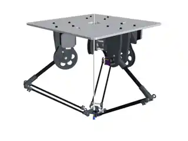
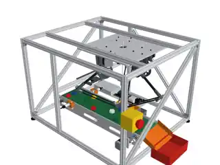

# Delta Robot — Parametric CAD & MuJoCo Model 🦾

**Collaborative robotics project · CAD v2 · MuJoCo / CadQuery / Python**

A parametric Delta parallel robot and conveyor-cell design for a planned high-speed pick-and-place system. The archive documents mechanical design, inverse/forward kinematics, drive geometry and a generated MuJoCo model.



> **Scope:** This repository package represents the **CAD v2 and simulation-model assets supplied in `deltarobot.zip`**. The complete pick-and-place control application, ROS 2 integration, STM32 firmware and live physical implementation are **not** in the uploaded archive. No physical robot performance is claimed here.

## Project at a glance

| Subsystem | Documented implementation |
|---|---|
| Robot | 3-arm Delta mechanism, parallelogram rods, tool platform |
| Geometry | Base radius 110 mm, moving-platform radius 30 mm, upper arm 170 mm, lower rod 260 mm |
| Actuators | NEMA 17 stepper motor specification, GT2 20T → 120T belt reduction (6:1), TMC2209 planned |
| Encoder provision | AS5600 magnetic angle sensors in the CAD assembly |
| Cell | Conveyor, bins, camera, through-beam sensor, vacuum tool, electronics tray |
| CAD | CadQuery with parametrization in `config/robot.yaml` |
| Simulation model | MuJoCo MJCF, meshes, body/inertia metadata, saved validation report |
| Drawings | 11-page mechanical drawing PDF, source CAD parts and design notes |

### Design visualization



## Source code and project structure

- [`cad/build.py`](cad/build.py): generates robot/cell CAD, part exports, MuJoCo bodies and reports.
- [`cad/delta_cad/`](cad/delta_cad/): parametric geometry, parts, robot, cell, drives, MuJoCo model export.
- [`analysis/kinematics.py`](analysis/kinematics.py): inverse/forward Delta kinematics, Jacobian and velocity/acceleration methods.
- [`config/robot.yaml`](config/robot.yaml): authoritative geometry and simulation design parameters in the source archive.
- [`cad/out/mujoco/`](cad/out/mujoco/): MJCF model, bodies JSON and saved validation report. **The 61 external STL mesh files are not published yet; regenerate them from CAD source before loading the XML.**
- [`cad/README.md`](cad/README.md): detailed original CAD-v2 assembly and manufacturing notes.
- [`docs/Delta_CAD_Drawings_Preview.pdf`](docs/Delta_CAD_Drawings_Preview.pdf): 11-page **lower-resolution preview** of the technical drawings (not a manufacturing-quality original).
- [`media/previews/`](media/previews/): 15 compressed WebP preview images of the robot and pick-and-place cell (full-resolution PNGs remain in the offline archive).

The original archive includes large generated STEP assemblies and individual STEP/STL part exports. They are **not included in this GitHub source repository**. The full MuJoCo STL meshes and full-resolution render PNGs also remain in the original offline ZIP; the repository contains lightweight visual previews and the MJCF definition.

## Running source checks and rebuilding the model

Basic kinematics checks use NumPy and PyYAML (no physical robot required):

```bash
python -m pip install numpy pyyaml
python -m unittest discover -s tests -v
```

The [GitHub Actions source checks](.github/workflows/source-checks.yml) also compile the Python files and run these tests.

**To obtain MuJoCo meshes:** The GitHub repository includes `cad/out/mujoco/delta_cell.xml`, but **not the external STL meshes referenced by this XML**. Regenerate geometry on a compatible machine with CadQuery/OpenCascade and the packages in `requirements-cad.txt`:

```bash
python -m pip install -r requirements-cad.txt
python cad/build.py
python -m mujoco.viewer --mjcf cad/out/mujoco/delta_cell.xml
```

CAD rebuild and full MuJoCo validation have **not been verified in this publication workflow**. The original offline ZIP contains the pre-generated mesh set and full-detail drawings. Refer to the [CAD source README](cad/README.md) and [project limitations](docs/PROJECT_SCOPE.md).

## Results and status

The archived MuJoCo validation report records an approximately 0.023 mm maximum closure residual during simulated movement tests, with measured simulated target errors below 0.1 mm in the four archived motion trials. These are **stored simulation results**, not new results or physical tracking accuracy. Read [validation summary](docs/VALIDATION_SUMMARY.md) or the [raw report](cad/out/mujoco/validation.json).

See [**what has been uploaded and what remains missing**](docs/UPLOAD_STATUS.md) and the [gallery of 15 CAD previews](media/previews/README.md).

## Collaboration and attribution

This is collaborative work. Contributor roles and redistribution permissions should be documented before making the repository public. No open-source license is included by default.

**Portfolio curator:** [Ilyes Dinedane](https://github.com/dinedane-ilyes7). All authors and collaborators should be credited with their actual contributions.
