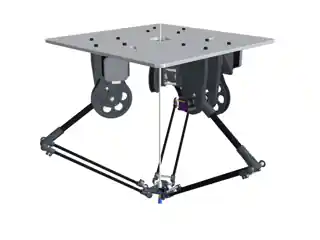
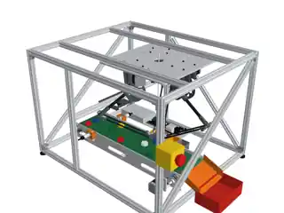
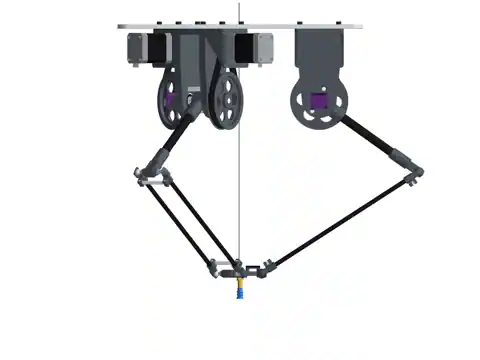
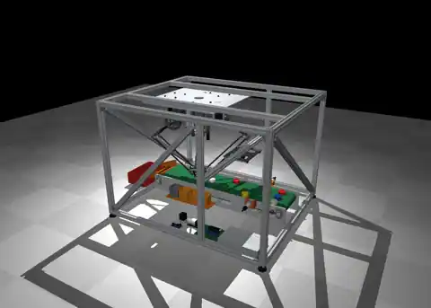
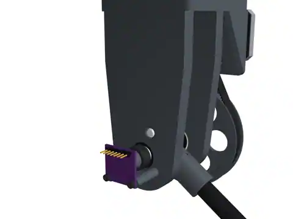
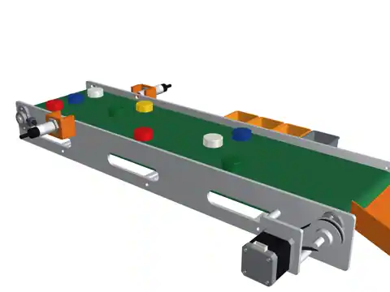

# Delta Robot visual gallery

These are lightweight **WebP preview images resized from the 15 original PNG renders in the supplied CAD-v2 archive**. They document the robot and conveyor-cell CAD design; they are not photos of a manufactured system.

| View | Preview |
| --- | --- |
| Robot isometric |  |
| Full cell |  |
| Robot front |  |
| MuJoCo geometry |  |
| Drive and encoder |  |
| Conveyor |  |

Additional mechanism, electronic, camera, and platform views are included in this folder. The original full-resolution renders remain in the prepared offline ZIP and have **not** been substituted with invented photographs.
